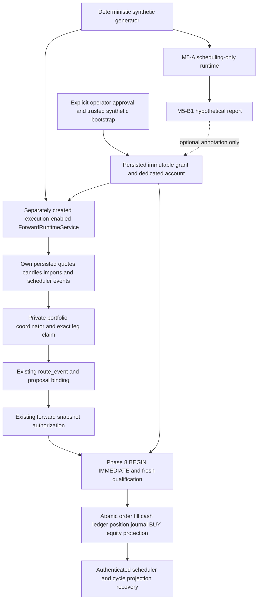

# M5-B2 authenticated synthetic portfolio paper execution contract

**Prepared:** 2026-11-20, Asia/Kolkata.
**Status:** CONTRACT PREPARED; implementation and execution BLOCKED pending the
explicit approvals and prerequisites in section 17. This document creates no
execution authorization. The application remains `RESEARCH_ONLY`.

The project owner reports bounded technical ACCEPT for M5-A and M5-B1. The current
conversation also records the bounded M5-B1 re-audit. These statements do not
establish independent organizational sign-off, operational readiness, real-data
eligibility, or acceptance of overall M2. Older status documents remain dated
snapshots; this specification does not silently update their status claims.

## 1. Scope and exclusions

The first implementation is one explicitly authorized synthetic portfolio cycle
on one new, dedicated Phase 8 simulated account, with INR 10,000 initial capital.
The frozen symbol order is `NSE:INFY`, `NSE:RELIANCE`, `NSE:TCS`. Resolve their
database IDs from the registry; never infer symbol order from numeric IDs.

The cycle contains INFY BUY 10, RELIANCE BUY 10, TCS HOLD 0, at one specified
completed one-minute candle opportunity per symbol. Quantities are fixed requests,
not quantities copied from an M5-B1 approval. Changed execution prices can reject
a request; there is no automatic downsizing, retry at a later opportunity, or
redistribution to a peer. Each BUY is all-or-none. The portfolio cycle is **not**
all-or-none: one valid instrument can fill while another is rejected.

Only active NSE cash EQUITY, authoritative decimal ticks, lot size one, integer
shares, long-only positions, existing Phase 8 costs/risk/halts, and existing
stop/target monitoring are permitted. Both a stop and target are mandatory for
these new BUYs. Subsequent fresh synthetic observations may trigger the existing
full-position protective SELL path. No discretionary SELL, scale-in, second entry
cycle, margin, borrowing, leverage, partial fill, cross-sleeve transfer or re-entry
after an exit is included. An open position is reported as open; cycle completion
does not force liquidation or claim a realized return.

Excluded: brokers, provider/live feeds, credentials, paid services, LLM/ML decision
authority, general portfolio management, a second order/fill engine, M2 historical
execution changes, M2-E, dashboard/CLI execution buttons and normal application
database access. Implement and demonstrate only in explicitly designated disposable
synthetic databases after separate authorization. No source, schema, runtime,
authorization, order, fill or database changes are authorized by preparing this file.

Normative terms: MUST is required for acceptance; a proposed API/table below is
specified future work, not an assertion that it currently exists.

## 2. Existing authoritative interfaces and verified limitations

Source anchors refer to the inspected worktree at HEAD
`0d6c65a69b94345fea170017128c632d52b5f9e9`, including its pre-existing uncommitted
M5-A/M5-B1 changes. The commit alone does not identify those worktree bytes.

| Existing interface | Actual responsibility and required reuse |
| --- | --- |
| `portfolio_pretrade._PortfolioPretradeCoordinator.evaluate(request)` | Rebuilds nested request before opening one read-only transaction; returns only a hypothetical report. No proposal, grant or reservation is derived from it. |
| `portfolio_pretrade._equal_budgets(cash)`, `portfolio.CapitalAllocation`, `SleeveCashAllocation`, exact paise converters | Reuse the fixed-cash allocation contract: 3333.34 / 3333.33 / 3333.33. `_equal_budgets` is private; do not turn its report coordinator into an execution coordinator. |
| `portfolio_qualification._qualify_portfolio_request(database_path, request)` | Historical daily M2-B qualification, common read snapshot and registered batch. Not forward execution eligibility. |
| `portfolio_execution._qualify_and_execute_portfolio_request(database_path, request)` | Historical M2-C composition of M1B. MUST NOT be called to produce forward paper orders or fabricate a forward qualification token. |
| `ForwardRuntimeService.create(database_path, runtime_id, account_id, instrument_ids, calendars, *, max_candidates=5, max_quote_delay_seconds=30, degraded_after_seconds=10, stale_after_seconds=30, max_execution_price_deviation=None, created_at=None, observation_only=False, scheduling_only=False)` | Creates persisted runtime/import provenance and runtime inception. Existing account/runtime creation uses separate transactions. A future optional `portfolio_run_id` keyword is specified below. |
| `ForwardRuntimeService.open(database_path, runtime_id, calendars=None)` | Existing startup authentication/recovery boundary. Opening is potentially mutating, not a dashboard read or a harmless evidence conversion. |
| `process_quote(quote)`, `schedule_event(instrument_id, interval, candle_timestamp)`, `_candle_decision_eligibility(connection, candle)` | Existing quote checks, aggregation and causal scheduling. Preserve F1/F2/F3 behavior and authorized scheduler writes. |
| `prepare_evidence(instrument_id, interval, as_of, *, event_id=None, proposal_id=None)` | Reloads persisted runtime evidence. Requires an execution-enabled runtime. Evidence as-of is the original event decision time. |
| `build_mock_proposal(event_id, action, quantity, *, stop_loss=None, target_price=None)` | Constructs a deterministic proposal from the stored candle, with event identity and one-interval expiry. It does not itself bind the event or grant execution. |
| `execution_snapshot(instrument_id, quote, *, interval='1m')` | Constructs an execution quote snapshot; the coordinator must reload the accepted quote rather than accept a caller quote payload. Phase 8 checks its contents again. |
| `route_event(event_id, proposal, snapshot)` | Journals the decision, binds the proposal using the existing one-use scheduler-write capability, delegates through the existing router, and later finalizes scheduler/protection projections. |
| `ForwardPaperTradingEngine._route_runtime_proposal(proposal, evidence, *, execution_snapshot, runtime_id, event_id, evaluation_time)` | Validates bound proposal/runtime evidence and delegates to `_route_proposal`. Generic `route_proposal` refuses runtime evidence/imports. |
| `paper_trading.submit_paper_order(database_path, account_id, idempotency_key, request, snapshot, *, forward_event_id=None)` | Sole authoritative simulated order/risk/fill boundary. Uses `_transaction`: `BEGIN IMMEDIATE`, commit or rollback. Rechecks authorization, evidence, reconciliation, cash, holdings and risk. |
| `paper_trading._forward_context_error(..., require_authorization=...)`, `_assert_forward_causal_order(...)` | Check exact proposal/event/quote/snapshot linkage and causal ordering inside Phase 8. Preserve all checks; add portfolio restrictions without a bypass flag. |
| `RiskLimits`, `CostAssumptions`, backtesting `_fill_price`, `_fees`, `_fee_total` | Existing risk definitions and deterministic adverse price/tick/fee arithmetic. Do not copy these into a replacement calculator. |
| `paper_equity.verify_account_inception(conn, account_id, session)` and `verify_snapshots(conn, account_id, session)` | M4's read-only authentication. The former is suitable for unused inception activation; its origin-chain financial-session check is not a general used-account verifier. |
| `paper_equity.capture(conn, account_id, at, kind, event_key, *, session=None, source_id=None)` | Existing evidence sidecar in the financial transaction; uses a savepoint and can return `None` on failure. Current Phase 8 does not require success. |
| `decision_journal.capture_runtime_decision`, `_order_intent`, `_order_result`, `finish_runtime_decision` | Existing append-only intent/result rules. Successful BUY result linkage is already mandatory inside the financial transaction; outer measurements/finalization are separate. |
| `ForwardRuntimeService._recover_committed_outcomes(conn)`, `_recover_exit_controls()`, `recover_scheduler_events()`, `decision_journal.recover_order_links(database_path, runtime_id)` | Existing authenticated recovery of projections/supplemental links, not permission to execute missing historical decisions. |
| `database.get_readonly_connection(path)`, `get_connection(path)`, `initialize_database(path)` | Read-only/query-only snapshots; existing writable connection/capability factory; transactional migration history. Source schema is 18; no assertion about any normal on-disk DB. |

Important current gaps, not claims of existing support:

1. `_require_execution_runtime` rejects scheduling-only and observation-only
   runtimes. M5-A's coordinator also requires scheduling-only mode. Neither can be
   repurposed as the M5-B2 execution coordinator.
2. Runtime/import/event/evidence/snapshot identities include runtime ownership.
   Event identities are immutable. Relabeling M5-A rows is invalid.
3. `ForwardPaperTradingEngine._route_proposal` commits an `AUTHORIZED` row before
   calling Phase 8. Runtime proposal binding is another prior transaction; scheduler
   finalization and trade-control installation are subsequent transactions.
4. Phase 8 serializes account cash spending, but currently has no forward fixed
   sleeve entitlement. A coordinator-side cash check alone is insufficient.
5. Current `paper_equity.capture` is deliberately best-effort. M5-B2 cannot promise
   atomic complete BUY equity evidence without a narrowly scoped stricter check.
6. Current checks predominantly compare quote/proposal times to snapshot `as_of`.
   M5-B2 also needs trusted evaluation time under the financial write lock, so an
   old internally consistent snapshot cannot be newly executed after expiry.
7. M5-B1 requires **exactly** schema 18 and a flat scheduling-only account. Running
   its evaluator on a used M5-B2 account or a future schema 19 DB is unsupported;
   do not relax it just to make it an execution dependency.

## 3. Exact proposed private interfaces and caller/callee map

New orchestration lives in `src/aegis/portfolio_paper_execution.py`. It owns no
fill arithmetic or account balance. All dataclasses named below are frozen,
slotted and recursively rebuilt at each boundary. Exact field schemas are in
section 4. No public exports are added to `aegis.__init__`.

```python
def _register_portfolio_run(
    database_path: Path, grant: _PortfolioPaperGrant
) -> _PortfolioRunRef: ...


def _activate_portfolio_run(database_path: Path, run_id: str) -> _PortfolioRunRef: ...


def _close_portfolio_entries(database_path: Path, run_id: str, *, reason_code: str) -> None: ...


class _PortfolioPaperCoordinator:
    @classmethod
    def open(cls, database_path: Path, run_id: str) -> _PortfolioPaperCoordinator: ...
    def execute_cycle(self, request: _PortfolioCycleRequest) -> _PortfolioCycleResult: ...
    def reconcile(self) -> _PortfolioReconciliation: ...


def _claim_portfolio_leg(
    conn: sqlite3.Connection,
    run_id: str,
    event_id: str,
    proposal: DecisionProposal,
) -> _PortfolioLegRef: ...


def _portfolio_order_context(
    conn: sqlite3.Connection,
    account_id: int,
    idempotency_key: str,
    request: PaperOrderRequest,
    snapshot: ExecutionSnapshot,
    *,
    forward_event_id: str | None,
) -> _PortfolioOrderContext | None: ...


def _validate_portfolio_debit(
    conn: sqlite3.Connection,
    context: _PortfolioOrderContext,
    request: PaperOrderRequest,
    snapshot: ExecutionSnapshot,
    *,
    fill_price: Decimal,
    fee_total: Decimal,
) -> None: ...


def _finalize_portfolio_fill(
    conn: sqlite3.Connection,
    context: _PortfolioOrderContext,
    *,
    order_id: str,
    request: PaperOrderRequest,
) -> None: ...


def _reconcile_portfolio_run(conn: sqlite3.Connection, run_id: str) -> _PortfolioReconciliation: ...


def _portfolio_now() -> datetime: ...
```

| Interface | Exact permitted caller -> callee and transaction ownership |
| --- | --- |
| `_register_portfolio_run` | Explicitly authorized local synthetic test/bootstrap harness -> this function -> read authentic fresh account/inception, then persist immutable grant plus REGISTERED event in its own `BEGIN IMMEDIATE`. No AI tool, dashboard or arbitrary cycle request may call registration. |
| `ForwardRuntimeService.create(..., portfolio_run_id: str | None = None)` (new optional keyword) | Same trusted bootstrap harness -> existing runtime creator -> verify registered account/runtime identity before creation and store run ID in immutable config. Ordinary callers retain `None`; a registered account cannot use that default to evade the portfolio path. |
| `_activate_portfolio_run` | Same bootstrap harness -> registration/current runtime/account/equity validators -> append ACTIVE event. Own transaction, no ingestion/submission. |
| `_close_portfolio_entries` | Trusted harness/operator stop or coordinator expiry handling -> append ENTRIES_CLOSED through existing DB transaction factory. It cannot clear a Phase 8 halt, revoke protective authority or rewrite a grant. |
| `Coordinator.open` | Authorized synthetic harness/restart path -> existing `ForwardRuntimeService.open`, existing journal recovery, then reconciliation. Authenticate the registered run/config/account before invoking mutating recovery; allow recovery for ACTIVE and closed runs. Never auto-activate REGISTERED. |
| `execute_cycle` | Authorized harness -> request reconstruction -> persisted manifest/event/quote lookup -> `build_mock_proposal`, `_claim_portfolio_leg`, `execution_snapshot`, `route_event` in that order per symbol. It never calls `submit_paper_order` or inserts a forward execution authorization directly. |
| `reconcile` | Coordinator and read-only reporting -> one read-only transaction -> `_reconcile_portfolio_run`. This method writes nothing and does not call `ForwardRuntimeService.open`. |
| `_claim_portfolio_leg` | Coordinator only, after building the exact stored-event proposal -> manifest and event validators -> insert immutable leg/proposal hash. Caller owns `BEGIN IMMEDIATE`; no financial writes. Duplicate identical claim returns original reference; conflict raises before routing. |
| `_portfolio_order_context` | `submit_paper_order`, inside its existing financial transaction for every **new** order -> account registration, run/leg/binding/authorization/ownership checks. A second call from forward authorization creation performs preliminary checks without replacing Phase 8's check. Returns `None` only for an entirely unregistered legacy account/runtime. |
| `_validate_portfolio_debit` | `submit_paper_order` -> run context and actual Phase 8 calculated price/fees -> sleeve/cash/protection/clock checks before order persistence. It raises `PaperTradingError` on failure; no partial commit. |
| `_finalize_portfolio_fill` | `submit_paper_order` after its ledger/position/result writes -> install/verify BUY trade controls or deactivate a fully closed protective position in the same connection/transaction. No new fill calculation. |
| `_reconcile_portfolio_run` | Phase 8 new-BUY context, coordinator recovery/read-only reporting, activation -> existing financial/M4 verifiers plus mappings/invariants in section 12. Caller supplies an already active transaction. Does not dispatch, capture missing old equity, change grants or repair balances. |
| `_portfolio_now` | Portfolio validators called inside Phase 8 and coordinator -> `datetime.now(UTC)`. No caller-provided timestamp, environment override, or production clock injection. Tests may monkeypatch this private wrapper and existing time gates consistently. |

New M4 adapter, in `paper_equity.py`:

```python
def verify_portfolio_account(
    conn: sqlite3.Connection,
    account_id: int,
    session: str,
    *,
    origin_snapshot_id: str,
    origin_sha256: str,
    account_sha256: str,
    runtime_inception_sha256: str,
) -> tuple[list[dict[str, Any]], list[dict[str, Any]]]: ...
```

Only `_reconcile_portfolio_run` calls this adapter; its proof arguments come from
persisted registration/activation records, never from a cycle caller. It reuses
M4's existing identity, canonical hash, financial invariant, sequence and ownership
verification. Exact handling of the historical account-only chain is in section 12.
The existing public `verify_snapshots` ownership contract remains unchanged.

`_PortfolioOrderContext` is an ephemeral, exact-type, rebuilt record loaded inside
the caller transaction: run/grant hash, account/runtime/instrument/event/proposal
identity, leg action/quantity/stop/target, allocation, entry state, proof references
and trusted evaluation time. It is never returned to a user or accepted as a
capability argument by Phase 8. Every new submission reloads it from SQL.

## 4. Input/output schemas, validation and identity

All ID text is exact `str`, nonempty, bounded to 256 characters. SHA-256 values
are exact lowercase 64-character hexadecimal strings. IDs in SQLite are positive
exact `int`, within SQLite signed integer range; bool, floats, Decimal quantities
and subclasses of expected contracts/containers are rejected. Decimal money/prices
must be exact finite `Decimal`, not strings or binary floats at Python boundaries.
Use existing bounded financial precision and canonical decimal text helpers; initial
cash/sleeves are exact paise, prices are tick-valid, and individual charges use
existing Phase 8 rounding. Do not impose two decimals on instruments with finer
authoritative ticks. Timestamps are exact aware `datetime`, normalized to UTC;
persist UTC microsecond `Z` text. Tuples contain recursively detached exact types.
No permissive `int(...)`, `Decimal(float)` or truthiness coercion at input boundaries.

### 4.1 Immutable operator grant

`_PortfolioPaperGrant` fields:

| Field | Type and exact constraint |
| --- | --- |
| `run_id`, `operator_approval_ref` | `str`; explicit nonsecret approval reference, not an access token or proof by itself. Trusted registration is the authority boundary. |
| `account_id`, `runtime_id` | `int`, `str`; fresh unused account and planned **new** execution runtime, exclusive for this run. Runtime ID must not already exist at registration. |
| `initial_cash` | `Decimal('10000.00')` exactly by value; authenticated against persisted original account inception. |
| `universe` | Exact tuple `('NSE:INFY','NSE:RELIANCE','NSE:TCS')`. |
| `sleeve_budgets` | Exact tuple of reconstructed `SleeveCashAllocation`; validated by `CapitalAllocation` against initial cash and canonical order. |
| `instrument_ids` | Tuple of three positive exact integers in symbol order, independently registry-resolved; frozen registry/tick fingerprint also persisted. |
| `legs` | Tuple of three `_PortfolioLegPolicy` records in symbol order. |
| `risk_policy_sha256`, `cost_policy_sha256` | Canonical fingerprints of reconstructed **persisted** `RiskLimits` and `CostAssumptions`. A caller hash cannot replace their source. |
| `calendar_sha256` | Approved local synthetic-fixture calendar fingerprint with CONFIRMED coverage for the specified session; no promotion of checked-in CONFIGURED data. |
| `max_execution_price_deviation` | Exact finite nonnegative Decimal absolute INR price difference, explicitly supplied and stored in runtime config. No implicit default or percentage reinterpretation. |
| `not_before`, `entry_expires_at` | UTC instants; `not_before < entry_expires_at`; opportunities and execution must lie within this half-open entry window. |
| `b1_report_sha256` | `str | None`; optional annotation only, never read as permission, cash or price. No M5-B1 result object accepted. |

`_PortfolioLegPolicy` fields: `instrument: str`, `instrument_id: int`,
`action: Literal['BUY','HOLD']`, `quantity: int`, `candle_timestamp: datetime`,
`stop_loss: Decimal | None`, `target_price: Decimal | None`. Exact actions/quantities
are BUY/10, BUY/10, HOLD/0 respectively. The specified candle is session-aligned 1m;
all three policies specify the same candle boundary. Both BUY protection prices
are required, positive, tick-valid and stop < target. HOLD protection fields are
`None`. At proposal construction require stop < candle entry < target; under the
financial lock also require stop < modeled BUY fill < target. Never widen stops
or targets automatically when execution prices change.

`grant_sha256 = SHA256(canonical grant JSON)`. Persist a version
`aegis.portfolio-paper-grant/v1`, the account proof, origin snapshot ID/hash and
registry fingerprint alongside that JSON. These discovered proofs are populated by
registration, not accepted as authenticated caller assertions. The run ID has a
unique association with the canonical grant; reuse with different material fails.

### 4.2 Cycle and references

`_PortfolioCycleRequest(run_id: str, grant_sha256: str)` is the entire execution
input. It contains no prices, balances, quantity overrides, quote objects, passing
quality flags, execution clock, arbitrary event IDs or approval booleans. Cycle ID
is `SHA256(canonical(['aegis.portfolio-cycle/v1', run_id, grant_sha256]))`.
Malformed requests fail before DB access; a well-formed unknown/stale grant fails
before binding, authorizing or submitting anything.

Resolve each exact scheduler event using the existing `_event_id` algorithm on
the registered runtime, instrument, `1m` and manifest candle. Do not concatenate a
new parallel event identity. `_PortfolioRunRef` contains run/grant/cycle IDs and
registered account/runtime IDs. `_PortfolioLegRef` contains run, instrument, event,
proposal ID and canonical proposal hash. References are locators, not bearer tokens.

### 4.3 Results

`_PortfolioLegResult`: instrument, action, requested integer quantity, event ID,
proposal hash if claimed, phase, reason-code tuple, optional order/fill IDs,
actual filled integer quantity, optional actual Decimal fill price/cost/debit,
and `duplicate: bool`. Phases: `NOT_AVAILABLE`, `PENDING`, `HOLD`, `REJECTED`,
`FILLED`, `INTEGRITY_BLOCKED`. Only an authenticated Phase 8 fill permits FILLED,
positive filled quantity, costs/debit and a fill ID. HOLD has zero economics and
no order/fill/forward authorization. A projected reservation is never called a fill.

`_PortfolioCycleResult`: run/grant/cycle IDs, entry lifecycle state, canonical tuple
of three leg results, account cash, tuple of sleeve cash, actual total BUY debit,
actual fees, open-position identities, reconciliation status and reason-code tuple.
Cash/economics are optional only when reconciliation is unavailable, with explicit
`None` and `INTEGRITY_BLOCKED`, never fabricated zeros. Missing opportunity at the
specified cutoff remains NOT_AVAILABLE/PENDING until entry expiry, then is recorded
as unavailable, not rewritten to HOLD. `entries_complete` means all entry legs have
terminal decisions or recorded expiry/unavailability; it does not mean flat.

`_PortfolioReconciliation`: run/grant/cycle IDs, `status: Literal['RECONCILED',
'FAILED']`, bounded canonical reason tuple, authenticated account/sleeve cash and
holdings if available, order/fill/equity/journal references and evidence fingerprint.
Recompute totals from authoritative records, not from stored cycle output. Results
are frozen and reconstructed before return; validate identity, status/economics,
cross-links, totals and canonical SHA-256. Stable financial/evidence content hashes
exclude measurement durations, diagnostic duplicate flags and query wall time; any
separate receipt JSON must label these nonfinancial fields. After an actual exit,
cash/holdings/evidence naturally change. M5-B1 report fingerprints are not reused.

## 5. Execution trust boundary and M5-A compatibility



There is deliberately no M5-A event/import -> executable evidence edge. The new
runtime has a new runtime ID, new dedicated account, new runtime-owned import IDs,
quotes, event IDs, inception and manifests. The same in-process synthetic generator
may deliver deterministic observations to both runtimes, in causal order. Each
runtime validates/accepts and aggregates those observations independently using
the existing machinery. This is regeneration of evidence under a separately
authorized owner, not rebinding or trusting a serialized M5-A artifact.

The execution runtime is created with `observation_only=False`,
`scheduling_only=False`, `portfolio_run_id=run_id`, explicit deviation and
`max_candidates >= 3`. Its provider remains `DETERMINISTIC_SYNTHETIC`, mode
`RESEARCH_ONLY`. Do not use `_MultiInstrumentCoordinator`, whose contract is
scheduling-only; this coordinator delegates quote ingestion directly to the
existing execution runtime. No mode flags on an existing runtime may be edited.

Add persisted mode/config/account-run checks to the portfolio Phase 8 path as well
as the existing public runtime guards. Generic submissions, a second runtime, or
a hand-built snapshot cannot bypass account registration. Keep M5-A's prohibitions
on evidence preparation, proposal creation, routing, marks and monitoring unchanged.
Observation-only provider accounts remain ineligible. Direct transfer/continuation
of the original M5-A account or its pending events is a **blocking prerequisite**
requiring a different reviewed contract; this contract does not support it.

## 6. Transaction sequence and atomicity

Use the current single SQLite database, connection factory, WAL and 5000 ms busy
timeout. No network or blocking external work inside write transactions; lock
timeout returns a retryable infrastructure error without inventing a decision.
Do not place `route_event` inside an outer write transaction: its existing APIs
open their own connections. There is no cross-connection or portfolio-wide atomicity.

### T0a–T0c: trusted bootstrap, separately recoverable

1. Harness creates the fresh account through `create_paper_account`, with explicit
   risk/costs and initial cash; validate complete original INITIAL evidence.
2. T0a `_register_portfolio_run` freezes the grant/origin proofs and REGISTERED
   event. Registration requires no orders, fills, positions, ledger/P&L/daily state,
   marks, forward authorizations or other runtime ownership. From this commit,
   every Phase 8 new order for this account is gated even before a runtime exists.
3. T0b existing runtime creation checks the registered account/planned runtime,
   stores immutable run association and captures runtime inception. No observations
   are ingested before activation. A missing/incomplete inception leaves REGISTERED.
4. T0c activation verifies exclusive runtime ownership, mode, costs/risk/registry,
   source/calendar configuration, authentic original/current INITIAL chains, exact
   funding and unused financial state, then records ACTIVE with runtime config and
   runtime-inception hashes. Never replace or recapitalize a failed bootstrap.

T0a/T0b/T0c are not atomic together; a crash leaves an inert registered account or
an unactivated runtime. Re-run idempotent registration/activation only after
authentication. `Coordinator.open` cannot infer operator activation from existence.

### T1–T5: one leg at a time, canonical symbol order

1. Reload run lifecycle and clock, reconcile prior committed work, resolve exact
   eligible completed event and latest accepted quote. Build the proposal from
   stored candle via `build_mock_proposal` with manifest quantity/stop/target.
2. T1 claim: insert exact immutable leg/event/proposal identity in one write
   transaction. No cash reservation or execution authorization is created.
3. `route_event` captures its existing decision intent; T2 binds UNBOUND -> BOUND
   using `_authorize_scheduler_event_write('BIND_PROPOSAL', ...)`. The portfolio
   check verifies the claim and immutable proposal before allowing binding.
4. Router reloads evidence and snapshot qualification; T3 creates the existing
   `forward_execution_authorizations` PROPOSAL/AUTHORIZED row for the exact quote
   and snapshot. Add the persisted portfolio grant/leg/time check here too.
5. T4 `submit_paper_order` acquires `BEGIN IMMEDIATE`. Reload current grant/account,
   state, evidence and ledger; follow section 10. On success atomically commit:
   order/events, fill, cash ledger delta, position/P&L, daily state/marks as applicable,
   snapshot use, AUTHORIZED -> CONSUMED, mandatory BUY journal intent/result,
   complete BUY equity capture and BUY trade controls. On a valid Phase 8 rejection,
   its existing REJECTED order and AUTHORIZED -> REVOKED behavior remain. On a
   portfolio integrity exception or mandatory BUY write failure, rollback T4 in full.
6. T5 existing runtime finalizes event status/result and outer journal measurements.
   Its trade-control upsert must agree with the already committed T4 control. This
   is idempotent projection finalization, not a second grant or fill.
7. HOLD uses normal decision/evidence validation and journal/result finalization,
   with no T3 authorization and no T4 financial order. Do not skip it or treat it
   as authorization to spend its idle sleeve.

T4 strict BUY equity handling: after mandatory `_order_result`, invoke existing
`paper_equity.capture` in the caller transaction. Require a returned snapshot ID,
COMPLETE/RECONCILED payload and successful M4 authentication including the new fill.
`None`, malformed or incomplete evidence raises, rolling back order/fill/consumption
and controls. Apply only to registered portfolio BUYs. Preserve generic Phase 8
behavior and protective SELL best-effort analytics priority.

No durable *cash reservation* is needed: T3 authorizes an exact possible attempt
but grants no cash entitlement. T4 performs the complete sleeve/cash check and
debit while holding the SQLite write lock. Two AUTHORIZED rows cannot spend one
balance concurrently. Do not subtract M5-B1 modeled reservations or authorization
notionals from cash, or hold a financial lock across T1–T5.

## 7. State transitions

| Object | Allowed states/transitions | Authority |
| --- | --- | --- |
| Run entry lifecycle | REGISTERED -> ACTIVE -> ENTRIES_CLOSED -> CLOSED_FLAT; REGISTERED may close without activation; any nonflat lifecycle may become INTEGRITY_BLOCKED | Append-only run events after exact previous-sequence/hash comparison under write lock. CLOSED_FLAT requires authenticated zero positions and no executable pending entry. No transition back to ACTIVE; no second cycle. |
| Entry leg | Unclaimed -> CLAIMED -> BOUND/PENDING -> FILLED, REJECTED or HOLD | Claim row plus existing scheduler/order facts, not a new financial state machine. NOT_AVAILABLE/expired opportunity has a bounded run event and journal NO_DECISION where applicable. |
| Scheduler | PENDING/UNBOUND -> PENDING/BOUND -> FILLED, REJECTED or HOLD | Existing guards/capabilities/runtime. Terminal replay returns original outcome; terminal identity/content cannot change. LEGACY_UNVERIFIABLE is never admitted. |
| Forward authorization | Absent -> AUTHORIZED -> CONSUMED or REVOKED | Existing router creates, Phase 8 consumes/revokes. Never CONSUMED/REVOKED -> AUTHORIZED and never replace a snapshot for an event. |
| Account/position | Flat -> long after entry -> flat after protective exit | Phase 8 ledger and positions only. Run lifecycle is not an account balance. |

INTEGRITY_BLOCKED prevents new entries and remains durable. It does not itself
manufacture or clear a Phase 8 hard halt. Protective routing retains Phase 8's halt
classification and verified financial-ownership checks. Supplemental journal/equity
failure alone must not create a new hard halt that traps an otherwise valid exit.
No automatic clearing of a real reconciliation/integrity halt is permitted.

## 8. Authorization lifecycle and replay policy

There are three distinct authorities:

1. Explicit operator scope authorizes a trusted local harness to register this
   particular run. A Python dataclass, private name, hash, `source` label or
   `operator_approval_ref` supplied by an untrusted caller is not proof of approval.
   Do not expose registration through AI tools, a web endpoint or a dashboard.
2. The immutable persisted grant constrains account/runtime, one entry cycle,
   instruments/opportunities, quantities, funding, costs/risk and protection.
   ACTIVE and the trusted clock are checked before binding/authorization and again
   in Phase 8. Closing/expiry cancels unused entry permission, not existing positions.
3. The existing forward authorization is one-use for one exact event/proposal/
   snapshot/quote/import. Phase 8 remains its sole consumer. It is necessary but
   insufficient without the persisted run entitlement for registered accounts.

Authorization insertion is not funding reservation. If T4 rolls back, an already
committed AUTHORIZED row can remain. Restart does not automatically submit it:
unused entry authorizations encountered during recovery are REVOKED and their
claimed opportunities terminally rejected with `PORTFOLIO_INTERRUPTED_ATTEMPT`.
This is a conservative first-cycle policy; no later quote is substituted into the
same authorization. A fresh invocation may resume only unclaimed opportunities
that are still within the original manifest and event time windows. Claimed/BOUND
but uncommitted entries are also abandoned on restart; never rebuild them with
current prices and a historical decision time. Normal same-process duplicate
calls may read an already committed terminal result; uncertainty after an exception
requires recovery first.

For expiry/closure and abandoned attempts, revoke existing unused authorization
and terminalize pending scheduler projection in one recovery transaction after
proving no Phase 8 order exists. Never revoke CONSUMED. If any order exists,
authenticate/recover that order instead. Unclaimed missing-event opportunities
receive a run availability record and journal NO_DECISION, not a synthetic scheduler
event for nonexistent candles. No entries are reopened after closure or expiry.

Duplicate successful submissions use original proposal ID/idempotency key, order
request hash, consumed authorization and snapshot association. The current runtime
terminal-event/recovery path handles duplicate rejections; do not call the low-level
filled-order replay path with a REVOKED authorization. A different request with an
existing key is an integrity conflict, never a retry. Result lookup after expiry
may report authentic old facts, but cannot perform a new financial write.

## 9. Shared capital and sleeve accounting

One authoritative Phase 8 account; no shadow accounts per instrument and no second
cash ledger. Initial sleeve entitlements are immutable allocations, not deposits or
cash movements. Every fill/ledger entry must map through order/snapshot use to this
runtime and exactly one symbol's original entry or authenticated protective exit.

For symbol i, inside the same read/write snapshot:

```text
sleeve_cash[i] = initial_allocation[i]
                + sum(Phase 8 ledger.amount for authenticated orders of symbol i)
account_cash  = paper_trading._cash_balance(connection, persisted_account)
sum(sleeve_cash) == account_cash
BUY debit = actual modeled Phase 8 fill_price * integer_quantity + actual fees
```

Use exact Decimal addition with sufficient local precision, canonical text storage
and existing financial bounds. Do not round sleeve cash independently to conceal
sub-paise differences. Initial allocations are exact paise; actual debits follow
the existing tick/charge contracts. No mutable sleeve balance table is introduced.

Before a BUY, require debit <= that sleeve's current cash and <= account cash;
all sleeve balances must be nonnegative. One filled entry per symbol/run is the
maximum even after a protective exit returns cash. SELL proceeds and fees belong
to the same sleeve and cannot finance a peer beyond its original entitlement.
Reject an unmapped ledger entry, deposit, generic order, second producer or changed
initial cash rather than resplitting the remaining aggregate account balance.
HOLD reserves/debits zero and retains its entire sleeve.

Example-only unchanged prices can reproduce M5-B1's ₹3006.63 + ₹1002.54 debits and
₹5990.83 cash with the same costs and quantities. This is a test expectation, not
an execution promise. At actual execution time recompute prices/fees from the new
runtime's latest accepted quote. If INFY's fee-inclusive debit exceeds ₹3333.34,
reject its full BUY even if portfolio cash could cover it. RELIANCE remains eligible
only if fresh account-wide risk/halt/reconciliation checks still pass. No peer may
spend the rejected INFY or idle TCS entitlement.

## 10. Fresh execution-time qualification and risk sequence

Immediately before each **new** Phase 8 submission, under its `BEGIN IMMEDIATE`,
perform this deterministic sequence. Preflight is useful for diagnostics but never
substitutes for these checks. Integrity errors take precedence over ordinary risk
rejection; do not convert malformed data into a passing default.

1. Reconstruct exact request/snapshot/quality nested values; authenticate current
   persisted run, grant/event chains and account ownership. A registered account
   or runtime marker without its counterpart is an error, not a legacy fallback.
   Reject wrong mode/provider, observation/scheduling-only flags, changed immutable
   config, registry/tick metadata, risk/cost policy or grants. Require ACTIVE for
   entry, exact claimed opportunity/action/quantity and no prior entry use.
2. Obtain `now = _portfolio_now()` **after** lock acquisition. Require grant
   `not_before <= now < entry_expires_at`, original proposal `now < expires_at`,
   quote observed <= received <= now, nonnegative age <= persisted data-age and
   applicable feed/degraded limits, and receipt within the event's existing decision
   delay window. Preserve the stricter existing causal/order checks. Reject both
   clock rollback/future evidence and snapshots stale while waiting for the lock.
   Never replace snapshot `as_of` with now: it still means the persisted receipt.
   Protective SELL uses its existing exit expiry/quote rules plus trusted current
   freshness; entry grant expiry cannot cancel protective entitlement.
3. Independently reload exact event, BOUND canonical proposal/hash, runtime/account,
   instrument, interval, manifest candle, import and accepted quote. Verify the
   existing one-use forward authorization, snapshot identity/hash and quote content;
   no cross-symbol or cross-runtime binding. Require latest accepted quote and
   matching persisted cursor/price/healthy feed. Revalidate completed candle's
   historical provenance and F2 completion availability using existing checks.
4. Reload approved calendar using the administrator-selected file; require matching
   pinned configuration and CONFIRMED/FULL relevant session coverage. Re-run
   `analyze_dataset(..., connection=connection)` for the snapshot's actual as-of;
   require COMPLETE/FRESH/100%, source SYNTHETIC_STREAM and the exact runtime-owned
   import/hash/metadata/declaration, completed before cutoff, without ERROR issues.
   Check source at event evidence cutoff as well as current eligibility. Caller
   quality/evidence fingerprints cannot grant eligibility. Reload calendar before
   financial commit; changed fingerprint rolls back the BUY. File and SQLite state
   are not jointly locked: configuration replacement must remain prohibited during
   the bounded harness run; this is an operational prerequisite, not claimed
   cross-resource atomicity.
5. Reconcile Phase 8 financial relationships/cash/holdings, journal and equity with
   section 12 before adding risk. Reload current marks for all held peers and apply
   existing stale/future-mark rules. Verify mandatory controls for existing longs.
   A historical B1 flat-account report cannot authenticate the second BUY's used
   account. Missing or contradictory required BUY evidence blocks all new entries.
6. Respect persisted account/runtime halt classification and Phase 8 causal ordering,
   availability/lot/quantity/capacity constraints. SELL cannot exceed trusted holdings.
   Current fixed scope has no discretionary SELL; only an existing protective exit
   may bypass the entry-window requirement, never the financial/risk boundary.
7. Compute adverse fill price and rounded charges using existing `_fill_price` and
   `_fees`. Require fresh price within persisted absolute proposal deviation, valid
   stop < proposal entry < target and stop < modeled fill < target for BUYs.
   Then enforce sleeve affordability with actual fees under this write lock.
8. Keep Phase 8 `_risk_rejection` and its existing order-value, cumulative position,
   account cash, exposure, daily-state/daily-loss semantics authoritative. Add no
   alternate risk arithmetic or weaker comparison. B1's conservative hypothetical
   notional/exposure descriptions are not a replacement for Phase 8's actual mark-
   based calculations. Explicit orders are never partially reduced to fit.
9. Persist financial/journal/protection/BUY equity facts atomically as section 6;
   verify post-fill conservation before commit. If an ordinary rejection triggers
   the existing account risk halt, peers must honor it even if their preflight passed.

HOLD also requires authentic manifest/event identity, timely evidence and existing
journal gates; it submits no zero-quantity order. Record stale/unavailable HOLD
evidence as rejection/unavailability, not a successful HOLD based on missing data.

## 11. Failure and restart matrix

Recovery first reloads immutable manifests and authenticates actual Phase 8 facts.
It never treats a coordinator receipt, event FILLED label or authorization alone as
proof of a fill. Resolve committed outcomes before revoking orphan attempts.

| Interruption/failure | Durable state | Required behavior |
| --- | --- | --- |
| Before registration/activation | Possibly account or REGISTERED bootstrap only | No execution. Authenticate and explicitly finish activation or close; never silently recreate account/equity. |
| Before claim/authorization | No leg attempt or an unbound scheduled opportunity | Resume only original unclaimed, still-timely opportunity after fresh validation; otherwise explicit unavailable/expiry record. |
| After claim, before binding | Immutable claim, no order | Restart abandons claim, records interrupted attempt, terminalizes existing event and closes that leg. No later-price proposal replacement. |
| After proposal binding, before authorization | BOUND event and possibly journal intent | No fill exists. Authenticate then reject interrupted leg; append missing outcome only through existing journal rules. Binding remains immutable. |
| After authorization, before order | AUTHORIZED row, no financial order | Revoke unused authorization and reject interrupted leg in one recovery transaction. Never reuse for a fresh quote. |
| After order INSERT, before fill INSERT/commit | Uncommitted T4 writes | SQLite rolls back the whole T4 transaction on connection loss; earlier authorization may remain. Prove no order and apply interrupted-attempt rule. |
| After fill INSERT, before T4 commit | Uncommitted fill/ledger/position/journal/equity | Same rollback. No persisted partial fill or compensation trade is allowed. |
| After T4 commit, before scheduler/control projection finalization | Authenticated order/fill, CONSUMED auth, mandatory BUY journal/equity and T4 protection | Existing `_recover_committed_outcomes` authenticates and restores scheduler projection; T4 control must already protect the position. Do not submit again. |
| Committed rejection, scheduler still PENDING | REJECTED order, normally REVOKED auth | Recover terminal rejection using existing authenticated recovery. Never retry via low-level consumed-authorization replay or reissue authorization. |
| One instrument rejected, peers pending | Valid committed rejection plus current account state | Continue canonical peers only after fresh validation; retain current account-wide halt effects. Never borrow or compensate by increasing quantities. |
| Evidence changes/stales between T1/T3/T4 | Possibly BOUND/AUTHORIZED, no committed fill yet | Latest-quote/time/source/calendar check rejects or rolls back new order. Terminalize/revoke safely; no automatic rebinding to replacement evidence. |
| Crash in partially completed cycle | Some terminal legs, some absent/claimed | Recover terminal facts; abandon interrupted claims; resume only unclaimed timely manifest opportunities. Show partial completion; never fabricate missing decisions/fills. |
| Duplicate or concurrent replay | Same run/event/proposal/idempotency identities | Unique claim plus immutable binding and Phase 8 transaction admit at most one fill. Identical terminal lookup returns facts; conflicting request fails. |
| BUY journal intent/result write fails | T4 may have started | Roll back complete BUY. Earlier durable journal intent may remain pending; finalize as no committed fill only after proof. No analytics-based fill inference. |
| BUY equity capture missing/incomplete/fails | Existing capture may return None | Strict portfolio BUY check raises; roll back complete T4. Never backfill an invented historical equity snapshot. |
| Protective SELL supplemental journal/equity fails | Financial SELL may commit per existing priority | Preserve ledger/control updates, record bounded health gap where possible and close new entries. Recover journal links only from committed evidence. Missing original equity remains explicitly incomplete; no retrospective equity manufacture. |
| Missing control or ledger/journal/equity disagreement at restart | Possibly real open position | Block new entries; authenticate/recover only derivable projections using existing recovery. Conflicting financial facts require integrity halt/review. Do not clear a hard halt or fabricate protection from an unbound request. |
| Disk full/busy timeout/failure during recovery | Old committed facts remain | Stop/resurface retryable infrastructure failure; no progress claim or repeated implicit order dispatch. A failed recovery cannot reopen entry permission. |

Recovery may append truthful RECOVERY/UNKNOWN supplemental evidence under the
existing journal contract; it must not claim the original opportunity was evaluated
or passed quality checks when that evidence is unavailable. No restart dispatches
an old bound intent automatically. Protective monitoring resumes only after the
existing ownership/control/recovery prerequisites and requires fresh observations.

## 12. Reconciliation invariants and M4 evidence

For every ACTIVE/closed run, verify:

1. One immutable grant, one account, one runtime, exactly the fixed registry and one
   manifest opportunity per symbol. Registration/activation event hash chain is
   canonical, gap-free and valid. Account `account_proof` still matches its frozen
   inception proof, including funding, risk/cost JSON and creation timestamp.
2. Phase 8 `_reconcile(..., return_errors=True)` reports no financial relationship
   errors. Account cash equals initial cash plus its ledger; all ledger/fill/position
   facts belong to the run and instrument mappings. Per-sleeve sum equals account
   cash, with no negative sleeve and no hidden deposits or borrowing.
3. Every filled BUY maps to one immutable entry claim, BOUND event/proposal hash,
   CONSUMED PROPOSAL authorization, exact snapshot use, one order and one fill. No
   event/proposal/snapshot/order/fill is shared by legs or used by a second producer.
   Every protective SELL maps through its STOP_TARGET_EXIT authorization/control to
   that symbol's original claimed BUY. Rejected orders debit no cash.
4. Journal BUY intent and FILLED execution audit unambiguously link the same active
   decision, runtime, event, proposal, order, fill and snapshot. Read via existing
   journal validators, not bare unchecked JSON. Extra/conflicting links fail closed.
5. Each filled BUY has its original COMPLETE/RECONCILED M4 FILL snapshot, correct
   sequence/previous hash, authenticated financial references and as-of marks.
   All subsequent equity evidence is checked by existing M4 rules. Missing required
   evidence is a failure, not permission to capture a checkpoint as a substitute.
6. Each remaining long has one active control owned by its actual BUY proposal with
   the granted exact stop/target; no inactive/unowned control is treated as protection.
   Atomic T4 installation covers the fill-to-T5 crash gap. Existing recovery can
   restore an absent derivable projection only after authenticating its Phase 8
   source; it cannot widen exits or infer prices from a current caller proposal.
7. Actual fill price/fees/amounts, positions, realized records and controls agree.
   Read actual `paper_fills.fill_price`, not `ProposalExecutionResult.fill_price`:
   the router currently reports the reference quote there, before adverse costs.

### M4 used-account adapter requirement

`verify_account_inception` currently verifies an account-origin chain under a runtime
owner using all financial evidence. Once trades exist, that evidence belongs to
the runtime, so applying the flat-account adapter unchanged to the origin session
would reject an otherwise valid used account. Do not bypass M4 for the second BUY.

Implement `verify_portfolio_account` as a narrowly constrained adapter over the M4
verifier. Check exclusive current runtime owner, frozen original snapshot ID/hash,
frozen account proof and activated runtime INITIAL hash. For the account-only
origin, require **exactly one** original INITIAL/account-inception snapshot at the
authenticated account creation time, COMPLETE/RECONCILED, empty financial references,
zero positions/P&L/fees and cash/equity equal authenticated initial funding. Apply
the existing canonical, payload/row identity/hash and financial invariants to this
origin with an empty inception ledger; never replay today's runtime fills into an
earlier account-only session. Add a private `inception_only: bool = False` keyword
to `_verify_snapshots` only if needed to share this validation: it is valid only
with authenticated `inception_owner`, the exact origin session and the single
INITIAL record. It cannot skip verification of a runtime chain or a used financial
snapshot. Public `verify_snapshots` never supplies this keyword.

Verify the entire current runtime chain through the normal unfiltered M4 path,
including actual runtime fills, journal links, sequence, hashes, historical marks,
financial invariants, original runtime INITIAL and future-evidence checks. Require
the only equity sessions to be the original account-only session and the current
runtime. All work uses the same provided transaction; no second connection or
automatic repair. Missing protective SELL sidecars leave analytics incomplete and
new entries closed; they do not become a false COMPLETE valuation or an automatic
financial halt solely because supplemental analytics are missing.

## 13. Required database changes — proposed schema 19

**A migration is required for this design. None is performed or authorized now.**
Schema 18 cannot persist the grant, lifetime entry entitlement and immutable cycle
claims required here. Do not encode execution permissions in mutable JSON settings,
an M5-B1 result, a journal approval label or an in-memory set.

When separately authorized, use the existing `database.py` migration mechanism:
add `MIGRATIONS[18]` (18 -> 19), then `SCHEMA_VERSION = 19`. Do not renumber or
replace old migrations. Reconfirm no intervening migration exists before coding;
a version collision blocks work until reconciled, not overwritten.

Three new tables, no second financial ledger:

| Table | Exact columns and constraints |
| --- | --- |
| `portfolio_paper_runs` | `run_id TEXT PRIMARY KEY`, `account_id INTEGER NOT NULL UNIQUE REFERENCES paper_accounts(id)`, `runtime_id TEXT NOT NULL UNIQUE`, `grant_sha256 TEXT NOT NULL UNIQUE`, `grant_json TEXT NOT NULL`, `account_sha256 TEXT NOT NULL`, `origin_snapshot_id TEXT NOT NULL REFERENCES paper_equity_snapshots(snapshot_id)`, `origin_sha256 TEXT NOT NULL`, `registry_sha256 TEXT NOT NULL`, `created_at TEXT NOT NULL`. Grant is versioned JSON schema in section 4, max 65536 UTF-8 bytes. `runtime_id` is the **planned** identity and intentionally has no FK because registration precedes runtime creation; activation and every gate require the exact matching existing runtime. FK `account_id` and lifetime uniqueness remain. |
| `portfolio_paper_run_events` | `event_id TEXT PRIMARY KEY`, `run_id TEXT NOT NULL REFERENCES portfolio_paper_runs(run_id)`, `sequence INTEGER NOT NULL CHECK(sequence>0)`, `kind TEXT NOT NULL`, `recorded_at TEXT NOT NULL`, `previous_sha256 TEXT`, `payload_json TEXT NOT NULL`, `payload_sha256 TEXT NOT NULL`, `UNIQUE(run_id, sequence)`. Allowed kinds: REGISTERED, ACTIVE, ENTRIES_CLOSED, CLOSED_FLAT, INTEGRITY_BLOCKED, OPPORTUNITY_UNAVAILABLE, INTERRUPTED_ATTEMPT, RECOVERY. Payload max 16384 UTF-8 bytes. Lifecycle is the latest lifecycle-kind record; informational records never reactivate it. |
| `portfolio_paper_legs` | `run_id TEXT NOT NULL REFERENCES portfolio_paper_runs(run_id)`, `instrument_id INTEGER NOT NULL REFERENCES instruments(id)`, `event_id TEXT NOT NULL UNIQUE REFERENCES forward_scheduler_events(event_id)`, `proposal_id TEXT NOT NULL`, `proposal_sha256 TEXT NOT NULL`, `proposal_json TEXT NOT NULL`, `claimed_at TEXT NOT NULL`, `PRIMARY KEY(run_id, instrument_id)`, `UNIQUE(run_id, proposal_id)`. Canonical proposal uses existing `aegis.decision-proposal/v1`; max 16384 UTF-8 bytes, cross-checked against the manifest/event. No financial status/balance columns. |

All hashes have lower-hex/length checks; JSON must be an object, valid, bounded and
versioned where specified. SQL scalar/JSON identities must agree with `IS` checks
that reject NULL/missing/wrong-type identities. All timestamps use validated UTC
microsecond text. Canonicality, digest, financial Decimal validation and cross-row
semantics are verified in Python on every trust boundary, not assumed from JSON
validity. Run-event payload schemas:

- REGISTERED: grant hash and original account/origin proof references.
- ACTIVE: grant hash, runtime config hash, runtime INITIAL snapshot ID/hash and
  confirmation of the original proofs. Exactly one ACTIVE per run, no later mutation.
- ENTRIES_CLOSED/INTEGRITY_BLOCKED: grant hash, bounded reason code; close never
  cancels owned protective positions. CLOSED_FLAT also binds authenticated last
  financial/equity fingerprints proving no position or executable entry remains.
- OPPORTUNITY_UNAVAILABLE/INTERRUPTED_ATTEMPT: grant hash, instrument, exact manifest
  opportunity, optional existing event/proposal IDs and stable reason code. One
  semantically identical record per leg/kind; repeat returns original identity.
- RECOVERY: grant hash, exact authenticated affected event/order references and
  bounded action code; never contains a reconstructed market prediction.

Define `event_id = SHA256(canonical([run_id, sequence, kind, recorded_at,
previous_sha256, payload]))`; `payload_sha256 = SHA256(canonical(payload))`.
Allocate sequence and previous-event hash under `BEGIN IMMEDIATE`. Use a partial
unique index for one REGISTERED and one ACTIVE per run and uniqueness for per-leg
unavailability/interruption via validated payload identity. Define table triggers
rejecting UPDATE, DELETE and replacement/colliding INSERT; do not use `REPLACE`
or cascading deletion. A duplicate API operation must SELECT and validate existing
material rather than rely on conflict-ignore. Extend run/event/claim writes with
the existing connection-local one-use capability pattern: exact payload scoped,
consumed once, and unavailable on bare SQLite connections. This is local trusted
application integrity, not protection from an administrator replacing the whole DB.

Pin `portfolio_run_id` as immutable runtime configuration. Add a null-safe trigger
protecting existing runtime account/config identity fields against UPDATE; preserve
all existing rows and allow status/state/checksum/updated_at progression. No legacy
row is automatically enrolled, granted a run ID or made executable by migration.
Add index `(run_id, kind, sequence)` for lifecycle/activation lookup. Existing
authorization, scheduler and financial schemas retain their current identities;
their Python gates gain the run-account lookup and required same-transaction checks.

Migration acceptance: upgrade a populated disposable schema-18 fixture with
unchanged old table rows/history, NULL-safe runtime identity protection, table
immutability/capability rejection on raw connections, rollback of all new tables/
triggers/version if any DDL fails, and unchanged legacy financial behavior. No
normal DB inspection or migration is implied. M5-B1 remains an exact-schema-18
report service; demonstrate its unchanged acceptance on isolated schema-18 fixtures
and its existing fail-closed result on schema 19. Extending B1 schema support would
require a separately approved scope change and is not an M5-B2 prerequisite.

## 14. Required implementation files

These are a future allowlist, not edits authorized by this task:

| File | Required bounded change |
| --- | --- |
| `src/aegis/portfolio_paper_execution.py` (new) | Private contracts, bootstrap/grant lifecycle, fixed three-leg orchestration, claims, financial mapping/reconciliation and Phase 8 entitlement helpers. No fill engine. |
| `src/aegis/database.py` | Reviewed additive schema-19 migration, immutable run/claim/event capability writes and runtime identity guard. Preserve existing scheduler capabilities/migrations. |
| `src/aegis/forward_runtime.py` | Optional run association at creation; validate registered identity before ingestion/routing; exact claim check before binding; idempotent T5 protection verification; recovery integration. Preserve scheduling/observation guards and F1/F2/F3. |
| `src/aegis/forward_paper_trading.py` | Preliminary persisted grant/claim/clock validation in existing authorization transaction. Preserve route_event-only runtime routing and exact one-use authorizations. |
| `src/aegis/paper_trading.py` | Unconditional registered-account/run check for new orders, including generic-path rejection; actual fee-inclusive sleeve check inside existing financial transaction; trusted current freshness; atomic protection and strict portfolio BUY equity capture. Existing Phase 8 remains sole order/risk/fill writer. |
| `src/aegis/paper_equity.py` | Narrow used-account origin adapter sharing M4 verification, preserving public ownership checks and protective sidecar behavior. |
| `tests/test_portfolio_paper_execution.py`, `tests/integration/test_portfolio_paper_execution.py` (new) | Cases below, including deterministic process restart and concurrency. |
| Existing `tests/test_database.py`, `tests/test_forward_runtime.py`, `tests/test_forward_paper_trading.py`, `tests/test_paper_trading.py`, `tests/test_paper_equity.py` | Focused migration, legacy behavior, authority and recovery regressions at changed boundaries. Confirm exact existing test modules before edits. |
| `tasks/M5_B2_PORTFOLIO_PAPER_EXECUTION.md` | Record approved deviations and actual bounded validation evidence only after separate implementation/review. |

No changes required to M2 historical `portfolio_qualification.py` or
`portfolio_execution.py`, B1 allocation/report semantics, application mode, broker
code, dependencies or public execution exports. Keep imports acyclic: Phase 8 may
locally import the portfolio helper; orchestration imports runtime/Phase 8 types
without any registration or execution side effects at import time.

## 15. Required tests and adversarial cases

All future tests use disposable DB/log/calendar paths, explicit synthetic grants,
blocked sockets/HTTP and existing venv. Tests must assert financial rows and
transaction outcomes, not merely a return label. Compare complete DB dumps when
rejection is specified to have no side effects; compare scoped committed facts
when a truthful journal/recovery record or valid REJECTED order is required.

1. **Baseline and changed prices:** independent fee arithmetic for fresh 300/100/200
   synthetic quotes; initial allocation and two BUY/one HOLD, actual fill debit,
   per-sleeve/account conservation. Changed quotes within limits recalculate actual
   costs. Deviation, sleeve insufficiency, aggregate cash shortage and each existing
   risk limit reject without downsizing. Unused TCS/failed INFY cash never funds RELIANCE.
2. **Nested boundaries:** mutate frozen grant/request/proposal/quality/reference
   objects via `object.__setattr__`; Decimal fractional, float, bool and negative
   quantities, nonstring actions, subclasses, lists/dicts, duplicate/missing symbols,
   altered instrument IDs, money/cost/risk/calendar hashes, NaN/Infinity, naive/future
   time. Assert evaluation-time rejection before DB writes, no invalid fill.
3. **Authority:** fabricated B1 APPROVED result/fingerprint, fake approval reference,
   unknown/REGISTERED/closed/expired grant, removed run row, altered runtime marker,
   generic order, direct engine call, second runtime and cross-account grants all
   fail. Existing generic legacy accounts still behave as before. Register/revoke
   APIs are absent from AI tools and dashboards.
4. **M5-A isolation:** every existing scheduling-only/observation-only prohibited
   call remains prohibited and write-free as required. M5-A event/import/snapshot
   cannot bind or authorize a B2 order. Independent new runtime regeneration has
   distinct ownership and accepted source hashes; no copied/relabelled database rows.
5. **Binding/replay:** swap instruments, intervals, runtime IDs, event/proposal/hash,
   quote IDs, import/source declaration, snapshot contents or stop/target. BOUND
   payload immutable, raw SQLite event/claim/grant forgery rejected, CONSUMED and
   REVOKED cannot authorize another order. Identical duplicate cycles/orders have
   at most two entry fills total and zero HOLD orders; conflicting keys fail.
6. **Freshness/races:** accepted quote superseded between proposal/auth/submission;
   expiry while waiting for write lock; old self-consistent snapshot as-of versus
   trusted now; source revocation/calendar replacement, missing candle, F2 late/gap,
   peer stale/future marks, feed degradation, clock rollback and quote capacity.
   No caller clock or quality flag restores permission. Test trusted freshness
   for protective exits without entry-window gating.
7. **Inception/lifecycle:** changed persisted funding with matching caller cash,
   risk/costs or allocations; missing/corrupt origin/runtime INITIAL, wrong owner,
   sequence/hash gaps and rehashed contradictory equity. Verify a second BUY and
   restart authenticate a genuinely used account through the M4 adapter; origin
   isolation cannot conceal runtime fills or unexpected equity sessions.
8. **Concurrency:** use two real SQLite connections/processes with barriers at T1,
   T3 and T4, both different-symbol spend and same-leg replay. Demonstrate write-lock
   recheck of actual debit, lifetime unique claim and one-use snapshot/auth. No
   negative account/sleeve, double debit or mixed owner; busy timeout is not a fill.
9. **Crash matrix:** inject before/after every T0/T1/T2/T3/T4/T5 commit and between
   order/fill/ledger/journal/equity/control writes. Abrupt process termination tests
   SQLite rollback, not only Python exception rollback. Restart recovers committed
   facts, abandons interrupted claims, and never executes a historical bound intent.
10. **Protection:** missing/invalid stops or targets, changed prices crossing a
    protection bound, failed control write and crash after fill commit before T5.
    Each committed long already has exact T4 protection. Existing fresh stop/target
    triggers full-position SELL once; no short, re-entry or duplicate exit. Entry
    expiry/closure or supplemental analytics failure does not cancel protective
    entitlement; Phase 8 integrity halt still blocks it.
11. **Journal/equity faults:** fail BUY intent/result/capture writes separately;
    return None or incomplete snapshot; all T4 financial writes roll back. Protective
    supplemental failure preserves existing financial priority and explicit gaps.
    Mismatched journal/order/fill/use/auth/equity references block new entries.
    Recovery cannot replace missing original equity with a fabricated checkpoint.
12. **Migration/read-only/compatibility:** section 13 upgrade/rollback/immutability
    cases, non-enrollment of old accounts, default runtime/single-instrument Phase 8
    regression, B1 schema-18 behavior, read-only reconcile/report uses no repair,
    preserved M2 allocation/historical execution and zero normal DB/log access.

Future focused validation commands (not executed by this specification task):

```powershell
.\.venv\Scripts\python.exe -m pytest --import-mode=importlib -q tests/test_portfolio_paper_execution.py tests/integration/test_portfolio_paper_execution.py
# Run the affected existing Phase 8/M4/schema tests separately in default import mode.
# Select exact node IDs for the changes; do not run the full suite.
.\.venv\Scripts\python.exe -m ruff check <changed-python-files>
.\.venv\Scripts\python.exe -m ruff format --check <changed-python-files>
.\.venv\Scripts\python.exe -m mypy --follow-imports=silent <changed-production-files>
git diff --check
```

The angle-bracket file sets denote the actual implementation diff, not an executable
test selection or an assertion of already passing tests. Duplicate unit/integration
basenames need importlib collection; retain default mode for legacy test imports.

## 16. Explicit acceptance criteria

M5-B2 may receive bounded technical acceptance only with all of the following:

- Approved contract, migration and synthetic-only implementation scope; separate
  explicit authorization for the disposable execution demonstration. No claim of
  normal DB approval, live/provider eligibility or broker authority.
- Implemented exact private contracts and caller restrictions; no B1-to-order
  conversion or new externally exposed execution interface. M5-A guards unchanged.
- Phase 8 is demonstrably the only financial writer and final risk authority.
  New grant, latest evidence, trusted current clock and fee-inclusive sleeve checks
  are reloaded under the financial lock. Concurrency tests prove conservation.
- Complete valid two-BUY/one-HOLD cycle; independent actual accounting; each BUY
  journal/equity/control commit atomic with its financial facts. Changed-price,
  insufficient-cash, rejected-peer and account-wide-halt cases behave as specified.
- One-use authorization and deduplication are durable across processes; no
  authorization resurrection, retrospective execution, duplicate fill, implicit
  resplitting or second entry cycle. Recovery passes every interruption class.
- Used-account inception/current equity authentication works without weakening
  M4 public ownership/financial verification. Missing/conflicting evidence fails
  closed for entries and protective analytics gaps remain honest.
- Reviewed additive migration passes preservation, raw-write/capability and rollback
  tests; current source schema and actual fixture schema are reported distinctly.
- All required focused tests, lint, format, focused typing and diff checks have
  actual recorded results and reviewed final diff. Required checks not executed
  are reported as limitations, never assumed passes. Full suite is not required
  or authorized by this task.
- Distinct reviewer examines the bounded final implementation and evidence. Technical
  acceptance does not claim profitability, organizational sign-off, operational
  readiness, overall M2 acceptance or permission for later milestones.

## 17. Remaining prerequisites and blockers

**Contract deliverable: prepared. Existing-code execution readiness: BLOCKED.**
The following are specific release gates, not unspecified architecture choices:

| Gate | Required closure before execution |
| --- | --- |
| Authorization | Owner explicitly approves this contract, bounded implementation changes and schema migration on disposable fixtures; an actual synthetic run separately requires its exact grant/harness approval. This task authorizes only this Markdown file. |
| Runtime compatibility | New separately owned execution-enabled runtime/account and regenerated evidence must be demonstrated. Direct M5-A runtime/account/event promotion is unsupported and remains blocked. |
| Persistent entitlement | Schema-19 grant/event/claim tables, account-wide Phase 8 enforcement and exact write capabilities do not yet exist. In-memory authority or preflight cash checks cannot substitute. |
| Used-account equity | M4 origin adapter for an account with runtime fills must be implemented/tested before the second BUY. Existing B1 flat-account authentication cannot be reused unchanged. |
| Commit completeness | Strict portfolio BUY equity check and same-transaction protection installation must pass fault injection. Current best-effort capture and post-fill runtime control write alone do not meet this contract. |
| Freshness and recovery | Trusted current-time checks under lock, interrupted-authorization abandonment, durable replay and partial-cycle recovery must pass adversarial tests. |
| Concrete fixture policies | Trusted harness supplies explicit valid stops/targets, deviation, persisted RiskLimits/CostAssumptions, grant window and exact candle opportunity, local synthetic CONFIRMED calendar/session and registry/tick identities. No defaults are inferred from the B1 sample. |
| Review | Additive migration, Phase 8/M4 changes and focused implementation evidence require review; this contract is neither implementation evidence nor acceptance of those future changes. |

Preparation validation: read-only inspection of the existing source/interfaces,
contracts, migration definitions and Git state; only this specification file was
created. No test suite, runtime, migration, broker connection, execution grant,
order submission or fill workflow was run. `git diff --check` and final document/
worktree preservation checks are reported in the accompanying task response.
